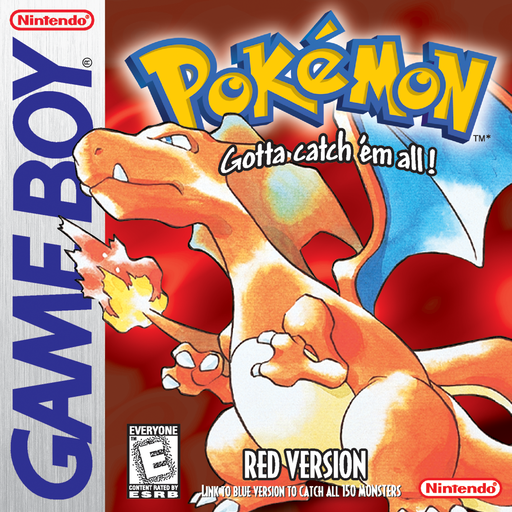
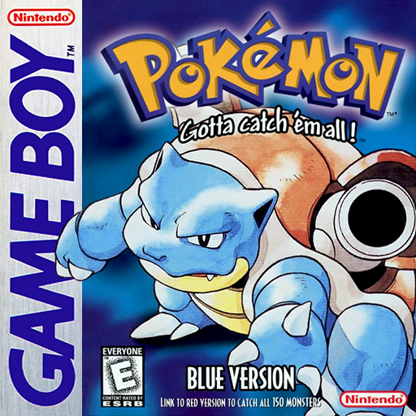

# Pokémon Red and Blue

 

Initial **Windows and Linux preview builds powered by gbcllr**. This is the existing game repository with its history retained. It previously used a gb-recompiled fork; the earlier implementation is preserved on [`legacy`](https://github.com/mstan/PokemonRedAndBlueRecomp/tree/legacy). The default branch now builds against the pinned gbcllr engine.

Adaptive overworld presentation, complete native actor poses and persistent wide color transitions. With separately generated native Extended data, the Mods page also offers the added species and optional expanded encounters. Battles and menus retain their original presentation.

The shared **GB/GBC recomp-ui** provides the cover-art launcher, input and audio settings, and in-game Mods (`Esc`). Adaptive **Fit to screen** is enabled for a fresh profile. Existing player choices are preserved. Enhancements use native hooks and host services; they do not modify the supplied ROM.

## Builds and current scope

Initial preview validation is complete for the delivered Windows/Linux builds. Full game-content, connected-play and sustained performance qualification remain ongoing; this is an experimental initial release. See the pinned engine’s `STATUS.md` for the accepted scope and known limitations.

Use the current game archive from the project’s release channel when available. Launch its Windows or Linux entry point, and retain your profile when updating. ROMs, boot ROMs, generated cartridge data, user saves and compiled binaries are not committed here.

## Build from source

Requires CMake 3.24+, Ninja, Python 3.11+, GCC or Clang with GNU C extensions, SDL2 and OpenGL. Windows uses a MinGW-w64 GCC/Clang environment; MSVC C is unsupported.

1. Obtain the gbcllr source, check out `engine_revision` from [`games.json`](games.json), and initialize its pinned submodules with `git submodule update --init --recursive`.
2. Supply your own original cartridge matching a SHA256 below. A matching boot ROM can be selected in the launcher or supplied as `GBCLLR_BOOT_ROM`.
3. Configure a separate build directory per variant, build, then open the generated `Play.cmd` (Windows) or `Play.sh` (Linux) beside `gbcllr-run`. These entry points use the shared graphical launcher.

```sh
cmake -S . -B build-red -G Ninja -DCMAKE_BUILD_TYPE=Release \
  -DGBCLLR_ROOT="/path/to/gbcllr" \
  -DGAME=red -DGBCLLR_ROM="/path/to/owned/game.rom"
cmake --build build-red --parallel 1
ctest --test-dir build-red --output-on-failure
```

Use `-DGAME=blue` and a separate `build-blue` directory for Blue. To include the optional native Extended package, set `GBCLLR_GEN1_EXTENDED_DATA` to data generated with the engine’s `tools/gen1_extended_data.py`; its documented donor inputs are read-only and are not included here.

Experimental linked play is included in source-build defaults. Compiling additional compatible cartridges requires `GBCLLR_ADDITIONAL_ROMS`; see the engine README for the exact content and peer-compatibility requirements.

| Variant | Model | Original cartridge SHA256 |
| --- | --- | --- |
| `red` | DMG | `5ca7ba01642a3b27b0cc0b5349b52792795b62d3ed977e98a09390659af96b7b` |
| `blue` | DMG | `2a951313c2640e8c2cb21f25d1db019ae6245d9c7121f754fa61afd7bee6452d` |

Native in-game saves and settings use the engine’s per-cartridge user profile. Back them up before changing installations. Save states are specific to a build. Artwork attribution is in [assets/boxart/README.md](assets/boxart/README.md).
